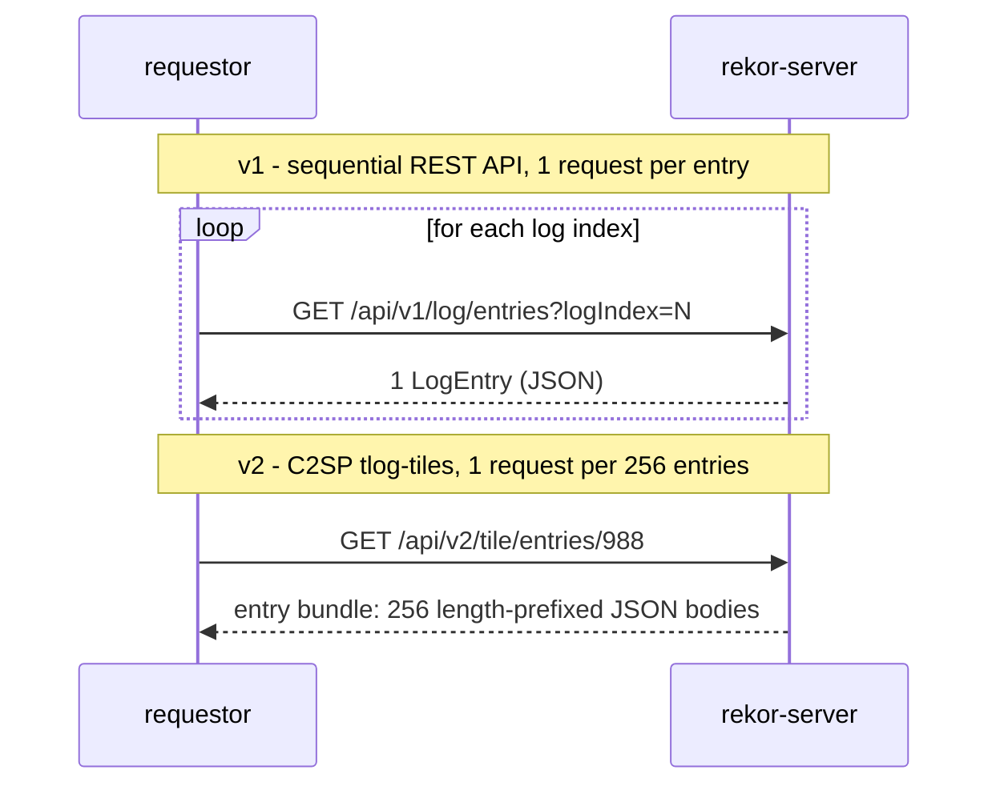
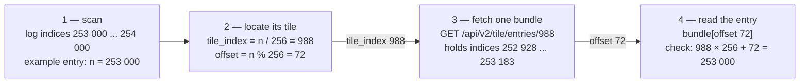

# rekor-leak

- [rekor-leak](#rekor-leak)
  - [Introduction](#introduction)
  - [Usage](#usage)
  - [Example output](#example-output)
  - [Rekor v1 vs Rekor v2: how the same log is read](#rekor-v1-vs-rekor-v2-how-the-same-log-is-read)
  - [example](#example)
  - [How it works](#how-it-works)
  - [Limitations](#limitations)
  - [Conclusion](#conclusion)


## Introduction

A small Rust POC that demonstrates that using a **public Rekor instance** could leak confidential metadata: it scans the transparency log and surfaces the **org / repository naming conventions**, **workflow names**, and **service-account identities** that build pipelines embed in their Fulcio signing certificates.

Transparency logs are append-only and public **by design**, that is the point. But each signed build publishes certificate extensions such as `SourceRepositoryURI`, `WorkflowName`, or the OIDC issuer of the signing token (see [Fulcio's OID documentation](https://github.com/sigstore/fulcio/blob/main/docs/oid-info.md)). Anyone able to read the log can therefore learn the shape of a private build infrastructure without ever cloning a repository.

> Read-only research tool. It does not bypass authentication or exploit Rekor. Keep scans small, respect the target's rate limits.

Concrete example: any build signed with keyless `cosign sign` _(or a release workflow attesting against the public Fulcio)_ is logged in the same public log, even when its source repository stays private, depending on the tool used to sign, it is recommended to double check the parameter used to sign to avoid leak.

The RekorV1 have a rate limit in place, it would be better to synchronize the the ledger locally to avoid that limitation, the v1 API is not optimized for large scans. On the v2, the architecture has changed and works per tile that allow to fetch with 1 request 256 entries to parse locally, it is more efficient.

## Usage

```bash
# Scan 1,000 entries starting at log index 200,000 (v2 default)
cargo run --release -- --start 200000 --count 1000

# Target a legacy Rekor v1 server (entry-by-entry REST API)
cargo run --release -- --server https://rekor.sigstore.dev --api v1

# Show the exact log indices and only explicit non-public repositories
cargo run --release -- --start 200000 --count 1000 --show-entries --private-only

# Machine-readable output
cargo run --release -- --start 200000 --count 1000 --json
```

Run `cargo run --release -- --help` for all options.

## Example output

```text
═══ [org] [redacted] (1 entries) ═══
  Repo Owner:   https://github.com/[redacted]
  Repository:   https://github.com/[redacted]
  Workflow:     build-image
  Runner Env:   github-hosted
  Visibility:   private
  OIDC Issuer:  https://token.actions.githubusercontent.com
  hashedrekord/0.0.2: 1 entries
```

## Rekor v1 vs Rekor v2: how the same log is read

Both APIs expose *the same entries*: each entry is identified by a **log index**, its position in the append-only tree. What differs is how a client fetches them.

Rekor **v1** is a sequential REST log: one entry per request.

Rekor **v2** follows the [C2SP tlog-tiles specification](https://c2sp.org/tlog-tiles) entries are packed 256 per tiles, served as static immutable files, so one request yields 256 entries. (See the source file for the full entry-bundle format.)
 


  
To read entry `n`, the client computes the tile that contains it. Worked example: the scan covers log indices **253 000 … 254 000**, so take the first entry `n = 253 000` — it lives in tile **988** (the tile covering indices `252 928 … 253 183`), at **offset 72** inside that tile:

```text
tile_index = n / 256          --> 253 000 / 256 = 988
offset     = n % 256          --> 253 000 % 256 = 72
bundle URL = /api/v2/tile/entries/{tile_index}   --> /api/v2/tile/entries/988
```



A tile **number** N is [encoded](https://github.com/C2SP/C2SP/blob/main/tlog-tiles.md#merkle-tree) in decimal, zero-padded to a multiple of 3 digits, then split into 3-digit groups, where every group but the last is prefixed with `x` — e.g. tile `1234` becomes `/api/v2/tile/entries/x001/234`, and tile `1234067` becomes `/api/v2/tile/entries/x001/x234/067`.

It is the tile *number*, **not a log index**, and the URL carries **only** the tile number never the offset. Example: log index `1234067` → tile `4820` (offset `147`) → fetch `/api/v2/tile/entries/x004/820`, then the entry is record 147 **inside** the returned 256-record bundle. 

_**Note:** The latest ongoing tile of the log is usually still **partial** and is addressed with a `.p/<width>` suffix, e.g. `/api/v2/tile/entries/x758/504.p/150` served the log's final 150 entries at the time of writing — that `150` is the tile's *width* (number of entries in it)._

## example

```bash
# example with log index 253000
curl -s https://log2025-1.rekor.sigstore.dev/api/v2/tile/entries/988 \
| python3 -c '
import sys
b = sys.stdin.buffer.read(); i = 0
while i < len(b):
    n = int.from_bytes(b[i:i+2], "big"); i += 2 # each record is prefix with its own length
    print(b[i:i+n].decode()); i += n' \
| jq -s '{records: length, log_index_72: (256 * 988 + 72), entry72: (.[72] | {kind, apiVersion,spec})}'
```

```json
{
  "records": 256,
  "log_index_72": 253000,
  "entry72": {
    "kind": "hashedrekord",
    "apiVersion": "0.0.2",
    [redacted]
  }
}
```

## How it works

- Rekor v2 is read through the C2SP tlog-tiles entry-bundle API (256 entries per request, see above).
- Rekor v1 is read entry by entry.
- Fulcio OID extensions are mapped to a `FulcioIdentity`; actionable identities are grouped by repository owner (`Org`) or, when only an individual identity is present, by email (`Email`).
- The POC currently extracts certificates from `hashedrekord/0.0.2`, `dsse/0.0.2`, and v1 `intoto/0.0.2` entries. Any other variant is simply not processed — finding private/internal repositories with a small scan was enough to validate the POC.

## Limitations

- Repository owner parsing currently supports GitHub URIs.
- `source_repo_visibility` is self-asserted by the CI provider and may be absent — so findings below `Visibility: private` are the only *affirmative* evidence; the other metadata leak even without it.
- Some providers keep their own fork of the Sigstore stack for private builds. GitHub, for example, signs **private-repository** artifact attestations through a private Fulcio instance with **no transparency log** ([docs](https://docs.github.com/en/actions/concepts/security/artifact-attestations))

## Conclusion

This is not a Rekor vulnerability; the log is public by design. It is recommended to take an extra step in the tool selection that performs the signature and publishing of the attestation, to validate which transparency log instance is used. The mitigation is one step away: prefer a path that never writes to a public log for private repos, or self-host your own Fulcio/Rekor.
